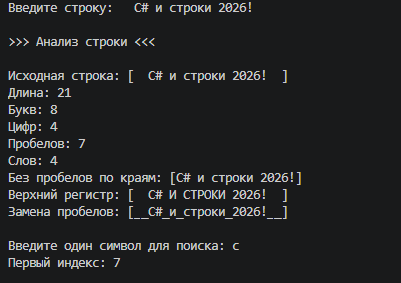

# Практическая работа №19

Автор: Алексеевская Елена
Группа: ИСП-251

## Тема

Строки в C#.

## Что реализовано

- определение длины строки;
- подсчёт букв, цифр, пробелов и слов;
- поиск первого индекса символа;
- удаление пробелов по краям;
- перевод в верхний регистр;
- замена пробелов на подчёркивания.

## Короткие ответы
1. Чем отличаются `string` и `char`?

Ответ: `string` - это строка, то есть последовательность символов, которя записывается в двойных кавычках (" "). `char` - это один отдельный символ, который записыватеся в одинарных кавычках (' '). У  `string` есть длина и доступ по индексу, а `char` - это элемент этой последовательности.

2. Почему вызов `text.Trim()` без сохранения результата не меняет `text`?

Ответ: Строки в C# неизменяемы. Методы не изменяют исходную строку, а возвращают новую. Поэтому `text.Trim()` без присваивания результата исходную переменную `text` не меняет - результат просто меняется.

3. Зачем при разделении строки используется `RemoveEmptyEntries`?

Ответ: `RemoveEmptyEntries` исключает пустые части, который появляются из-за пробелов по краям строки и нескольких пробелов подряд. Без это функции `Split()` для строки `" кот дом "` вернул бы массив с пустыми строками и посчитал бы лишние слова. 

## Результат

